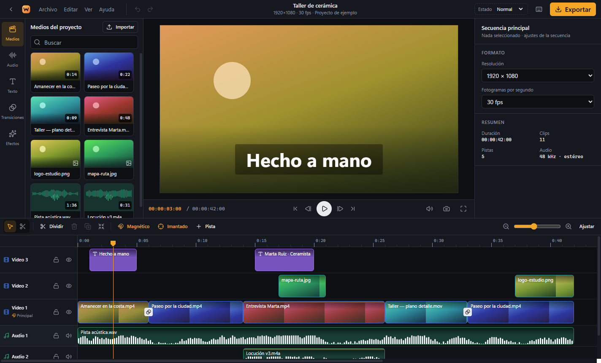
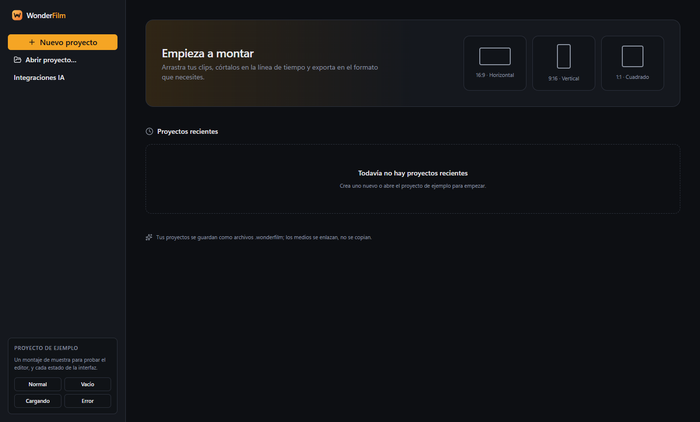
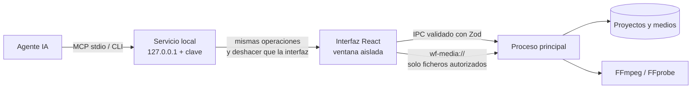

<div align="center">


# WonderFilm

**Editor de vídeo de escritorio para Windows: importa tus clips, móntalos en la línea de tiempo y exporta. Local, sin cuentas y controlable por agentes de IA.**




</div>

---

WonderFilm es un editor de vídeo de escritorio en español. Importas vídeo, audio e imágenes, los montas en una línea de tiempo con varias pistas, ajustas velocidad, efectos, títulos y transiciones, y exportas a MP4, MOV ProRes, WebM, GIF o MP3. Todo ocurre en tu equipo, sin telemetría ni subidas.

Además expone **29 herramientas por MCP y CLI** para que un agente de IA (Claude Code, Codex u otro cliente MCP) cree proyectos, importe medios, edite la línea de tiempo visible y exporte el resultado, sin recurrir a *computer use*.

> **Estado del proyecto.** Versión 0.3.0: temprana, pero plenamente funcional y cubierta por pruebas automáticas. Hay mucho margen para pulir y ampliar: las contribuciones son bienvenidas.

## Contenido

- [Características](#características)
- [Instalación](#instalación)
- [Uso](#uso)
- [Integración con agentes de IA](#integración-con-agentes-de-ia)
- [Configuración y datos](#configuración-y-datos)
- [Desarrollo](#desarrollo)
- [Arquitectura](#arquitectura)
- [Limitaciones conocidas](#limitaciones-conocidas)
- [Hoja de ruta](#hoja-de-ruta)
- [Contribuir](#contribuir)
- [Licencia](#licencia)

## Características

**Medios**
- Importa vídeo, audio e imagen desde el diálogo o **arrastrando desde el explorador**: a la biblioteca, o directamente a una pista en el punto donde se suelta.
- Genera miniatura, tira de fotogramas y forma de onda de cada medio.
- Lo que el visor no puede reproducir (ProRes, HEVC…) recibe un **proxy** automático; al exportar se usa siempre el original.

**Línea de tiempo**
- Selección y cuchilla, dividir en el cabezal, recortar por los bordes, mover entre pistas, borrar con o sin onda, cerrar huecos, duplicar, copiar/pegar y agrupar.
- **Modo magnético** en la pista principal e **imantado** a bordes y cabezal.
- Pistas con bloqueo, ocultar y silenciar. Zoom con Ctrl+rueda. Deshacer y rehacer.

**Vista previa e inspector**
- Reproducción de vídeo y audio sincronizada con el cabezal, gobernada por el reloj de audio; pantalla completa.
- Velocidad (0,1×–10×) y **reproducción inversa** de vídeo y audio.
- Transformación (opacidad, escala, posición, rotación), volumen con **ganancia hasta el 200 %** y **fundidos de audio**.
- Efectos: blanco y negro, cálido, frío, contraste, viñeta y desenfoque.
- **Transiciones**: fundido cruzado, barrido, zoom, desplazamiento, desenfoque y fundido a negro. Conservan la duración de la línea de tiempo.
- Títulos con texto y color propios, y etiquetas de color en los clips.
- **Captura de fotograma** a resolución completa, que entra en la biblioteca.

**Proyecto y exportación**
- Proyectos `.wonderfilm` con nuevo, abrir, guardar y guardar como; **guardado automático**; recientes con portada.
- Aviso propio de cambios sin guardar al cerrar o al sustituir el proyecto: guardar, descartar o seguir editando. Si el guardado falla, el proyecto sigue abierto para reintentar.
- Exporta a **MP4 (H.264 o H.265), MOV ProRes 422, WebM VP9, GIF y MP3**, con progreso y cancelación.
- **Codificación por GPU** cuando está disponible; si falla, la exportación se repite por software.

**Privacidad y seguridad**
- Todo es local: sin cuentas, servidores ni telemetría.
- Ventana aislada (`contextIsolation`, `sandbox`, sin Node) y con CSP. La interfaz solo ve los ficheros que el proceso principal ha autorizado.
- Toda entrada del proceso principal se valida con Zod.
- El acceso de agentes está desactivado por defecto, solo escucha en `127.0.0.1` y usa una clave revocable.

## Instalación

Por ahora no hay versiones publicadas en **Releases**: el instalador se genera desde el código.

1. Prepara el entorno siguiendo [Puesta en marcha](#puesta-en-marcha).
2. Ejecuta `npm run dist`. Genera `desktop/dist/WonderFilm-Setup-<versión>.exe`.
3. Ejecuta el instalador. Muestra la licencia, permite elegir la carpeta, no necesita permisos de administrador, crea accesos directos en el escritorio y en el menú Inicio y asocia los ficheros `.wonderfilm` a la aplicación. Se desinstala desde *Configuración › Aplicaciones*.

> El instalador no está firmado digitalmente, así que Windows SmartScreen puede mostrar un aviso la primera vez. Elige **Más información → Ejecutar de todas formas**.

## Uso

1. En la pantalla de inicio, crea un proyecto (16:9, 9:16 o 1:1) o abre uno reciente. Para probar el editor sin tus propios medios, abre el **proyecto de ejemplo**.
2. Importa medios con el botón de la biblioteca o arrastrándolos desde el explorador.
3. Arrástralos a la línea de tiempo. Divide, recorta y mueve los clips; ajusta cada uno en el **inspector**.
4. Añade títulos y transiciones, y revisa el resultado en la vista previa.
5. Exporta eligiendo formato y calidad. El proyecto `.wonderfilm` se guarda aparte y sigue siendo editable; los medios se enlazan, no se copian.



### Atajos de teclado

| Acción | Atajo |
|---|---|
| Reproducir / pausar | `Espacio` |
| Herramienta de selección / cuchilla | `V` / `C` |
| Dividir en el cabezal | `Ctrl + B` |
| Borrar (deja hueco) / con onda | `Supr` / `Mayús + Supr` |
| Duplicar | `Ctrl + D` |
| Copiar / pegar | `Ctrl + C` / `Ctrl + V` |
| Agrupar / desagrupar | `Ctrl + G` / `Ctrl + Mayús + G` |
| Deshacer / rehacer | `Ctrl + Z` / `Ctrl + Mayús + Z` |
| Imantado | `N` |
| Fotograma anterior / siguiente | `←` / `→` |
| Ir al inicio / final | `Inicio` / `Fin` |
| Acercar / alejar / ajustar a la ventana | `Ctrl + +` / `Ctrl + −` / `Mayús + Z` |

La lista completa está también dentro de la aplicación, en el diálogo de atajos.

## Integración con agentes de IA

1. Abre **Ayuda → Integraciones IA** (también desde la pantalla de inicio) y activa **Permitir conexiones locales**.
2. Copia la configuración MCP y pégala en los servidores MCP de tu cliente. Incluye el ejecutable, el punto de entrada y el fichero de conexión de tu instalación; no hace falta instalar Node.
3. El agente ya puede usar las herramientas. También existe una CLI JSON:

```powershell
$env:WONDERFILM_CONNECTION = 'RUTA_ABSOLUTA_DEL_PANEL\agent-connection.json'
$env:WONDERFILM_CLIENT = 'mi-agente'
node desktop/agents/entry.cjs --cli tools
node desktop/agents/entry.cjs --cli project.get
```

| Área | Herramientas |
|---|---|
| Proyecto | `capabilities.get`, `project.get`, `project.create`, `project.open`, `project.save`, `project.configure` |
| Medios y pistas | `media.import`, `media.remove`, `track.add`, `track.update`, `track.closeGaps` |
| Clips | `clip.add`, `clip.update`, `clip.move`, `clip.trim`, `clip.split`, `clip.speed`, `clip.transition`, `clips.delete`, `clips.duplicate`, `clips.group`, `title.add` |
| Historial y vista previa | `history.undo`, `history.redo`, `playback.set`, `frame.capture` |
| Exportación | `export.start`, `jobs.status`, `jobs.cancel` |

Las herramientas editan el proyecto visible y comparten el deshacer de la interfaz. Los tiempos de entrada van en segundos. Incluye un *skill* listo para usar en [`desktop/agents/skills/wonderfilm-control`](desktop/agents/skills/wonderfilm-control/SKILL.md). La guía completa, con una receta paso a paso y el modelo de seguridad, está en [docs/AGENTES.md](docs/AGENTES.md).

## Configuración y datos

WonderFilm no necesita claves, cuentas ni ficheros `.env`. Todo se guarda en local:

| Qué | Dónde |
|---|---|
| Proyectos | Ficheros `.wonderfilm` donde tú los guardes |
| Recientes, proxies y miniaturas | Carpeta de datos de la aplicación (`%APPDATA%\WonderFilm`): `recents.json` y `media-cache\` |
| Capturas de fotograma | `Imágenes\WonderFilm` |
| Conexión local para agentes (puerto y clave) | `agent-connection.json` en la carpeta de datos. No lo compartas |
| Copias temporales de la reproducción inversa | Carpeta temporal del sistema; se borran al cerrar normalmente |

Variables de entorno:

| Variable | Para qué sirve |
|---|---|
| `WONDERFILM_CONNECTION` | Ruta al `agent-connection.json` que muestra el panel, para la CLI |
| `WONDERFILM_CLIENT` | Nombre del agente que controla WonderFilm. Es una etiqueta, no una identidad de seguridad |
| `WONDERFILM_QA_EXE` | Ruta a un `WonderFilm.exe` instalado: las pruebas se ejecutan sobre él |
| `WONDERFILM_QA_TEMP` | Carpeta para los temporales de las pruebas (por defecto, la temporal del sistema) |
| `WONDERFILM_QA_SOAK_MS` | Activa el ensayo sostenido de `agent-smoke` (por ejemplo, `600000` = diez minutos) |

## Desarrollo

### Requisitos

- Windows 10/11 x64. Las pruebas se han hecho en Windows 11.
- Node.js 22.12 o posterior (verificado con 24.15) y npm.
- Conexión a Internet durante la instalación: `npm ci` descarga Electron y los binarios de FFmpeg y FFprobe. No hace falta instalar FFmpeg por separado.

### Puesta en marcha

```powershell
git clone https://github.com/excellentaisolutions/WonderFilm-community.git
cd WonderFilm-community
npm ci --prefix desktop
npm run dev
```

`npm run dev` abre la ventana de WonderFilm con recarga en caliente. Si `npm ci` no descargó el binario de Electron (falta `desktop/node_modules/electron/dist`), ejecuta `node desktop/node_modules/electron/install.js`.

### Comandos

Desde la raíz (cada uno delega en `desktop/`):

| Comando | Qué hace |
|---|---|
| `npm run dev` | Abre la aplicación con recarga en caliente |
| `npm run build` | Compila proceso principal, puente e interfaz en `desktop/out/` |
| `npm run typecheck` | Comprueba los tipos del proceso principal y de la interfaz |
| `npm test` | Pruebas unitarias del modelo y de la exportación (esta última, con FFmpeg real) |
| `npm run test:e2e` | Compila y prueba el editor en Electron real con un perfil aislado |
| `npm run dist` | Compila y genera el instalador de Windows en `desktop/dist/` |

`npm --prefix desktop run preview` abre la versión compilada sin recarga.

### Pruebas

- `npm test`: 56 pruebas unitarias (Vitest) en 9 ficheros: operaciones de la línea de tiempo, grafo de exportación, exportación real con FFmpeg y su recuperación ante fallos de GPU, documento y seguridad del proyecto, identidad de ficheros, reloj de reproducción e indicador de actividad.
- `npm run test:e2e`: 26 casos del editor en Electron real. Deja su informe en `desktop/qa/artifacts/report.json`.
- `node desktop/qa/agent-smoke.cjs`: la pasarela de agentes con un cliente MCP real (descubre las 29 herramientas), la CLI y una exportación decodificada con FFmpeg.
- `node desktop/qa/preview-quality.cjs`: la vista previa en Electron real.

Las pruebas de Electron usan un perfil y una carpeta temporal propios, así que no tocan tus proyectos. Necesitan una sesión de Windows interactiva. Con `WONDERFILM_QA_EXE` se repiten sobre una versión instalada.

### Integración continua

Cada *push* a `main` y cada *pull request* ejecutan [`.github/workflows/calidad.yml`](.github/workflows/calidad.yml) en `windows-latest`: `npm ci`, `typecheck` y las pruebas unitarias. Las pruebas de Electron necesitan escritorio y se ejecutan en local.

### Estructura

```
WonderFilm-community/
├── desktop/
│   ├── src/main/                 # Proceso principal (Node)
│   │   ├── ffmpeg.ts             # Lanza ffmpeg/ffprobe (fuera del asar al instalar)
│   │   ├── media.ts              # Importación: análisis, miniaturas, tira, picos, proxy
│   │   ├── media-protocol.ts     # wf-media:// — sirve ficheros autorizados, con Range
│   │   ├── project-file.ts       # .wonderfilm (validado con Zod) y recientes
│   │   ├── export.ts             # Exportación, GPU con vuelta a software, captura de fotograma
│   │   ├── reverse-preview.ts    # Copias temporales para la reproducción inversa
│   │   ├── agent-service.ts      # Servicio local para agentes (127.0.0.1 + clave)
│   │   └── ipc.ts                # Canales fijos; toda entrada se valida con Zod
│   ├── src/preload/              # Puente mínimo (window.wonderfilm)
│   ├── src/shared/               # Contratos, esquema de agentes y grafo de exportación (funciones puras)
│   ├── src/renderer/src/features/
│   │   ├── timeline/             # Modelo (funciones puras + pruebas), componentes y arrastre
│   │   ├── editor/               # Store (Zustand + historial), reproducción y atajos
│   │   ├── preview/              # Visor y reloj audiovisual
│   │   ├── agents/               # Panel de Integraciones IA
│   │   └── library/ inspector/ project/ start/
│   ├── agents/                   # Punto de entrada MCP/CLI y skill portable
│   ├── qa/                       # Pruebas en Electron real
│   └── resources/                # Icono y avisos de terceros
├── docs/                         # Guía de agentes e imágenes
├── .github/workflows/            # Integración continua
├── LICENSE, NOTICE, THIRD-PARTY-NOTICES.md
└── package.json                  # Atajos a desktop/
```

## Arquitectura



El modelo de la línea de tiempo son funciones puras sobre microsegundos enteros, probadas por separado. La exportación convierte la secuencia en un grafo de filtros de FFmpeg (`src/shared/export-graph.ts`), también como función pura, y el proceso principal lo ejecuta leyendo siempre los originales.

## Limitaciones conocidas

- Solo Windows. El código usa Electron y podría portarse a macOS o Linux, pero no se ha probado ni empaquetado allí.
- Los filtros del visor son una aproximación: el visor no es una referencia de color calibrada. La exportación aplica los efectos con FFmpeg.
- La reproducción inversa en el visor necesita preparar una copia temporal (hasta 720p); exportar un clip invertido puede requerir memoria proporcional a su duración.
- La codificación por GPU solo se ha probado en un equipo; si falla, se repite por software.
- No hay transcripción automática, generación en la nube ni importación de proyectos de otros editores.
- Los montajes muy largos, en 4K o con muchas capas, y otros equipos y controladores necesitan más pruebas.

## Hoja de ruta

Ideas abiertas a contribución:

- [ ] Más transiciones y efectos, con fotogramas clave
- [ ] Corrección de color con vista previa fiel
- [ ] Subtítulos y transcripción local
- [ ] Versiones para macOS y Linux
- [ ] Interfaz multilingüe (hoy, solo en español)
- [ ] Instalador firmado y actualizaciones automáticas
- [ ] Actualizar Zod a la versión 4 (ver [Contribuir](#contribuir))

## Contribuir

1. Abre una *issue* para comentar el cambio antes de empezar si es grande.
2. Haz un *fork*, crea una rama y mantén el estilo existente: TypeScript estricto, el modelo de la línea de tiempo como funciones puras con sus pruebas, y toda entrada del proceso principal validada con Zod.
3. Pasa `npm run typecheck` y `npm test`. Si tocas la interfaz o la reproducción, también `npm run test:e2e`; si tocas las herramientas de agentes, `node desktop/qa/agent-smoke.cjs`.
4. Si el cambio añade o cambia una capacidad, actualiza en el mismo *pull request* este README y, si afecta a los agentes, [docs/AGENTES.md](docs/AGENTES.md) y el skill.
5. Abre el *pull request* explicando qué cambia, por qué y cómo lo has probado.

Dónde tocar cada cosa:

| Quiero cambiar… | Empieza por |
|---|---|
| Una operación de edición | `desktop/src/renderer/src/features/timeline/model/operations.ts` y sus pruebas |
| La interfaz | `desktop/src/renderer/src/features/` (una carpeta por área) |
| La reproducción | `desktop/src/renderer/src/features/preview/` |
| Un efecto, transición o formato de salida | `desktop/src/shared/export-graph.ts` (exportación) y el visor |
| Importación y proxies | `desktop/src/main/media.ts` |
| Una herramienta para agentes | `desktop/src/shared/agent-schema.ts` (contrato) y `desktop/src/main/agent-service.ts` (ejecución) |
| El instalador | `build` en `desktop/package.json` |

**Dependencias con avisos conocidos.** `npm audit` señala `zod` 3.25 (alto; se corrige en la 4.6.6) y `fast-uri` (moderado, transitivo a través del SDK de MCP). Actualizar a Zod 4 es un cambio mayor que afecta a toda la validación: es una buena primera contribución, con sus pruebas.

## Licencia

Puedes usar, modificar y distribuir WonderFilm, también con fines comerciales, según la [Apache License 2.0](LICENSE). Al redistribuirlo debes incluir una copia de la licencia, conservar los avisos de copyright y el contenido de [NOTICE](NOTICE), e indicar en los ficheros que modifiques que los has cambiado. La licencia no da permiso para usar los nombres ni las marcas del autor, y el software se ofrece sin garantía.

El instalador incluye software de terceros con sus propias licencias, entre ellos **FFmpeg y FFprobe bajo GPLv3**, que se ejecutan como programas independientes. Los detalles y las obligaciones al redistribuir los binarios están en [THIRD-PARTY-NOTICES.md](THIRD-PARTY-NOTICES.md).
